### `$ whoami`

CS + Math @ Mizzou (Dec 2026) → incoming Software Engineer at **Garmin**, Aviation Databases.

I like the layer under the app: services that keep running, pipelines that stay fresh without babysitting, and dashboards that tell you *why* something broke. Most of what I build starts as "this should run itself" and ends up on a Raspberry Pi in my apartment.

### 🌙 Featured — MU Planner

<table>
<tr><td>

**A course planner for Mizzou students — 100+ real users, $0/month to run.**

Python scrapers pull the course catalog, GitHub Actions re-runs them on a schedule, and the results ship as static JSON to a Next.js front end. No database, no server, no bill. All planning state lives in the browser, so there's nothing to secure or migrate.

   

[**Live →** mu.ailuruslab.dev](https://mu.ailuruslab.dev) · [Repo](https://github.com/zkbeyer/MU-Planner)

</td></tr>
</table>

### 🛠️ Also on the desk

| Project | What it is |
|---|---|
| **[FaultInjector](https://github.com/zkbeyer/FaultInjector)** | Chaos-engineering reverse proxy in .NET — injects latency, errors, and drops between services to see what actually breaks. |
| **Homelab** · [ailuruslab.dev](https://ailuruslab.dev) | k3s on a Raspberry Pi 5 with a custom Go service for health checks, backups, and recovery. Prometheus / Grafana / Loki for observability. Hosts a Minecraft server my friends actually play on. |
| **[Rewind](https://github.com/zkbeyer/Rewind)** | Spotify Wrapped, but whenever you want — real listening data plus AI-written takes on your taste. |

### 🧰 Toolbox

**Languages** &nbsp;      

**Infra & ops** &nbsp;        

**Web & data** &nbsp;      

currently: Go, distributed systems, and making the homelab survive a power outage

